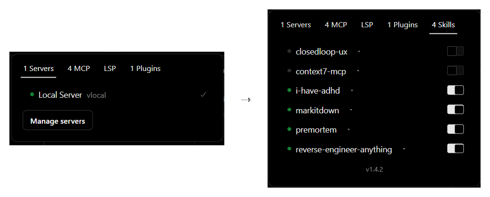

# SkillsTab

Adds a **Skills** tab to the OpenCode desktop status popover (next to Servers,
MCP, LSP, Plugins). Every installed skill has a switch: enable/disable it for
the model context.

## Before / after

  

## How it works

- `skills-scan.mjs` scans the same global/external skill roots opencode uses:
  `~/.config/opencode/skills`, `~/.claude/skills`, `~/.agents/skills`.
- Disabling renames `SKILL.md` to `SKILL.md.disabled` (and back). Nothing is
  deleted; the skill directory stays in place.
- The installer patches the real SolidJS popover chunk
  (`out/renderer/assets/status-popover-body-*.js`) so the tab is a native
  Kobalte tab: instant, same style, same selection behaviour, no stacked
  panels. The pristine chunk is kept in the asar as `*.js.orig` for `remove`.
- The opencode server loads skills once at startup, so a toggle applies after a
  restart. The panel shows a **Riavvia** button that relaunches the app.
- `links.json` maps a skill to the MCP servers it works with. Toggling the
  skill also connects/disconnects those servers immediately (the skill itself
  still applies at restart). If an MCP is turned off from the MCP tab, the
  skill shows a `MCP <name> off` badge: click it to reconnect. The MCP tab
  toggle stays runtime-only; no config file is rewritten.

Bundled `links.json` is empty (`{}`): no preconfigured link ships to other
users. Links are per-user and are created from the UI (or by editing the user
file manually).

### Link from the UI

Click a skill row (or the `▾` to the right of its name): the row expands into the
"Linked MCP:" panel with every configured MCP server. Toggle the ones you
want; changes are saved immediately, no restart needed (they affect the
cascade and the badge, not the model context). The switch at the right is the
skill on/off; clicking the row no longer toggles the skill. The skill name keeps
the same text color when off; only the status dot and the switch change.

UI strings are localized with the same method as the DeepSeek panel: system
language first, then the app language, English fallback (it/en).

User links are stored in:

    %APPDATA%\ai.opencode.desktop\skills-links.json

The file does not exist on a fresh install; it is created the first time you
change a link. An empty array for a skill disables links for that skill. Delete
the file to reset. A link to an MCP server that is not in the current config is
ignored: no badge and no connect attempt.

`context7-mcp` is not linked because no `context7` server is configured.
`ghidra-mcp` is unrelated to REA (REA uses its own Ghidra install).

The bottom of the Skills tab shows the installed version centered, prefixed
with `v` (e.g. `v1.3.2`), in a muted 11px gray (`#8a8a8a`).

Version 1.1 replaces the first DOM-injection version. Running `install` also
strips the old `skills-panel.js` injection and deletes the old file.
Version 1.2 adds `links.json`, the skill → MCP cascade and the reconnect badge.

## Install

Close OpenCode first (the patch writes `resources/app.asar`).

    cd SkillsTab
    node apply.js install

or double-click `installa.bat`.

OpenCode updates replace `app.asar`: re-run `install` after every update (and
re-run the installers of the other addons).

## Commands

    node apply.js remove       # remove only this addon (restores the chunk)
    node apply.js restore-all  # restore the pristine app.asar (all addons)
    node apply.js verify       # check the patched app.asar
    node apply.js status       # show install state

## Notes

- Project-local skills (`.opencode/skills`) are not listed: the desktop main
  process does not know the workspace directory.
- Custom `skills.paths` / `skills.urls` from `opencode.json` are not listed.
- If the same skill name exists in two roots, both rows are shown. The server
  keeps the last one it loads, so toggling the other copy may not change the
  model context.
- Toggling a skill mid-session does not affect the current context. Restart.
- If an OpenCode update changes the popover chunk internals, `install` fails
  with a clear "marker non trovato" error instead of writing a broken bundle.

## Files

- `apply.js` - installer (install / remove / restore-all / status / verify).
- `skills-scan.mjs` - discovery and toggle logic, testable standalone.
- `skills-main.js` - main-process IPC (`skills-list`, `skills-toggle`).
- `links.json` - bundled defaults (empty) for skill to MCP server mapping.
- `test_selfcheck.mjs` - runnable check: `node test_selfcheck.mjs`.
- `VERSION` - addon version.
